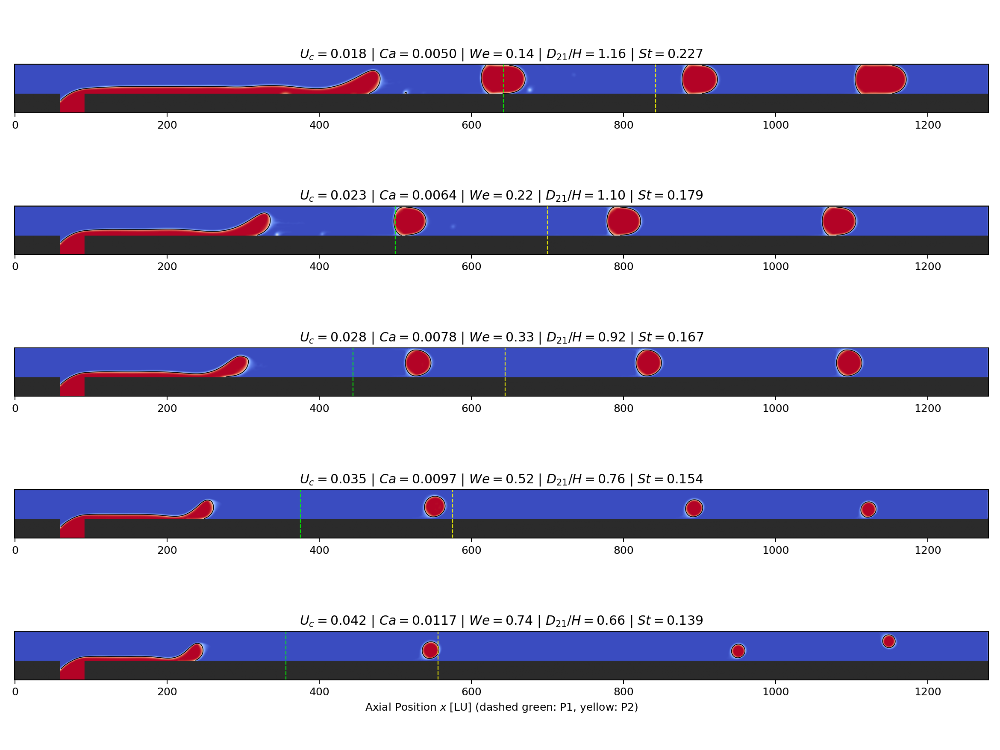
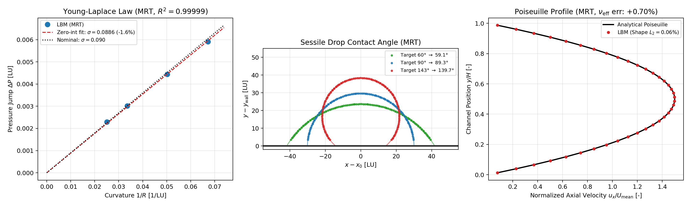
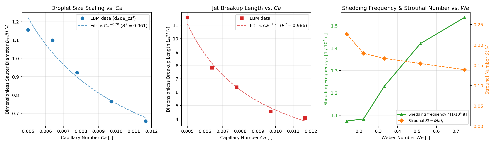
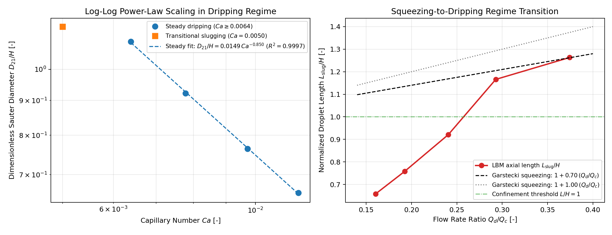
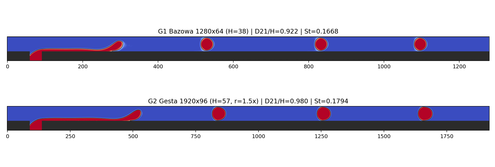
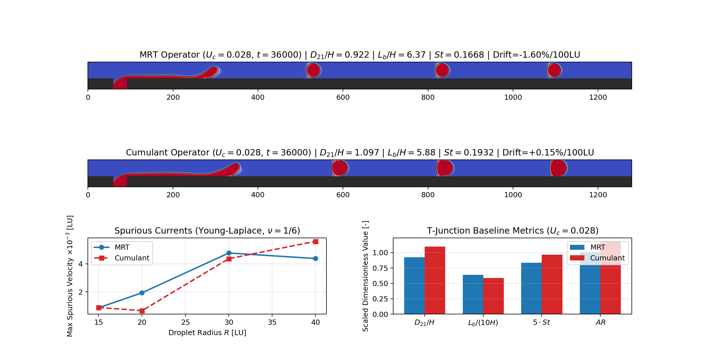

# Multiphase LBM Simulation & V&V Analysis of Droplet Formation in a 2D T-Junction

Verified 2D multiphase Computational Fluid Dynamics (CFD) study of cross-flow droplet generation in a T-junction channel using the GPU-accelerated Lattice Boltzmann solver **TCLB** (`d2q9_csf_viscstep` and `d2q9_csf_viscstep_cumulant`).

The workflow follows a structured CFD Verification and Validation (V&V) methodology: independent component verification benchmarks (Young-Laplace, Sessile Drop, Poiseuille), an automated five-point parametric sweep with adaptive dual-probe optical tracking, a constant-$\sigma$ Grid Independence Study (GIS) with GCI quantification, and a controlled comparison of **MRT vs. Cumulant** collision operators.

> **Physical Scope:** This study models a laminar, matched-density ($\rho_d/\rho_c = 1$, $\nu_d/\nu_c = 0.48$, $Re_c \in [27.4, 63.8]$) 2D T-junction representative of liquid–liquid microfluidic droplet generators and serves as a verified solver testbench for multiphase LBM collision operators.



## Key Engineering Results

### 1. Component Verification Benchmarks (MRT & Cumulant)
All verification tests were executed using the exact physical parameters of the micro-injector solver:

| Benchmark | Target / Analytical | MRT (`d2q9_csf_viscstep`) | Cumulant (`..._cumulant`) |
| :--- | :---: | :---: | :---: |
| **Young-Laplace** ($\nu = 1/6$, zero-int fit) | $\sigma = 0.09000$ | $0.08857$ (`-1.59%`, $R^2=0.9988$) | $0.08798$ (`-2.25%`, $R^2=0.9983$) |
| **Low-$\nu$ Laplace** ($R=40$, $\nu=0.025/0.012$) | $\sigma = 0.09000$ | Oscillatory ($\text{std}_\rho \sim 10^{-3}$) | **$0.09226$ (`+2.51%`, $\text{std}_\rho = 2.1\times 10^{-5}$)** |
| **Sessile Drop Wetting** (`WAD = 0.7`) | $60^\circ / 90^\circ / 143.24^\circ$ | $59.08^\circ / 89.26^\circ / 139.67^\circ$ | $59.01^\circ / 89.20^\circ / 139.44^\circ$ |
| **2D Poiseuille Profile** ($H = 38\text{ LU}$) | $L_2 = 0\%$ | Shape $L_2 = \mathbf{0.061\%}$ ($\nu_{\mathrm{eff}}$: `+0.70%`) | Shape $L_2 = \mathbf{0.060\%}$ ($\nu_{\mathrm{eff}}$: `+0.59%`) |



### 2. Parametric Sweep & Scaling Laws ($1280 \times 64$, MRT)
Sweeping continuous-phase inlet velocity $U_c \in [0.018, 0.042]$ at constant fuel velocity $U_d = 0.008$ resolves the transition from confined Taylor slugging ($L_{\mathrm{slug}}/H > 1$) to steady shear-dominated dripping:

* **Steady Dripping Sauter Diameter ($Ca \in [0.0064, 0.0117]$):**
  $$\frac{D_{21}}{H} = 0.0149\,Ca^{-0.850} = 0.5788\,We^{-0.425} \quad (R^2 = 0.9997)$$
* **Jet Breakup Length ($Ca \in [0.0064, 0.0117]$):**
  $$\frac{L_b}{H} = 0.0246\,Ca^{-1.140} \quad (R^2 = 0.9807)$$

| $U_c$ | $Ca$ | $We$ | $Re_c$ | $Q_d/Q_c$ | $D_{21}/H$ | $L_b/H$ | $St$ | $AR$ | Drift [\%/100LU] |
| :---: | :---: | :---: | :---: | :---: | :---: | :---: | :---: | :---: | :---: |
| `0.018`* | `0.0050` | `0.137` | `27.4` | `0.374` | `1.155` | `11.58` | `0.2267`* | `1.26` | `-0.05%` |
| `0.023` | `0.0064` | `0.223` | `35.0` | `0.293` | `1.098` | `7.83` | `0.1790` | `1.17` | `-0.89%` |
| `0.028` | `0.0078` | `0.331` | `42.6` | `0.241` | `0.922` | `6.37` | `0.1668` | `1.01` | `-1.60%` |
| `0.035` | `0.0097` | `0.517` | `53.2` | `0.192` | `0.764` | `4.55` | `0.1542` | `0.99` | `-5.16%` |
| `0.042` | `0.0117` | `0.745` | `63.8` | `0.160` | `0.658` | `4.07` | `0.1390` | `1.00` | `-5.55%` |

*\*Transitional lower-boundary slugging case ($L_b$ creeps downstream).*




### 3. Grid Independence Study ($r = 1.5$: `1280x64` vs. `1920x96`)
Constant-$\sigma$ mesh refinement at $U_c = 0.028$ ($Re = 42.56, Ca = 0.00778$) confirms topological invariance, cuts in-flight mass drift by **48.2%** (from `-6.08%` to `-3.15%/10H`, observed order $p = 1.62$), and yields a $+5.94\%$ sharp-interface shift in $D_{21}/H$ ($\mathrm{GCI}_{\mathrm{fine}} = 14.25\%$, $F_s = 3.0$).



### 4. Collision Operator Comparison: MRT vs. Cumulant
Switching from MRT to the Cumulant operator on the baseline $1280 \times 64$ grid ($U_c = 0.028$) produces major transport improvements without increasing mesh cost:
* **10.7× lower in-flight diameter drift:** `-1.60%/100LU` (MRT) $\to$ **`+0.15%/100LU`** (Cumulant).
* **65.5% lower droplet-to-droplet scatter:** `2.55%` $\to$ **`0.88%`**.
* **Higher volumetric mass recovery ($A_{\mathrm{drop}}/(Q_d T)$):** `46.3%` (MRT $G_1$) $\to$ **`75.9%`** (Cumulant $G_1$).



---

## Repository Structure

```text
projects/aerospace_injector/
├── README.md                        # Project overview and summary results
├── report.tex                       # Full LaTeX technical report with theoretical appendices
├── analyze_droplets.py              # Automated dual-probe optical droplet tracker
├── run_sweep.sh                     # 5-point parametric sweep automation script
├── plot_sweep.py                    # Scaling laws, Garstecki regime plot, and montage generator
├── plot_flow_fields.py              # Multi-field (phase, streamlines, pressure) visualizer
├── run_gis.sh / analyze_gis.py      # Grid Independence Study (1920x96) and GCI calculator
├── run_benchmarks.sh                # Young-Laplace, Sessile Drop, and Poiseuille test runner
├── analyze_benchmarks.py            # Automated analytical benchmark verification
├── run_cumulant_comparison.sh       # End-to-end MRT vs. Cumulant benchmark & injector suite
├── analyze_cumulant.py              # Side-by-side operator comparison script
├── benchmarks/                      # MRT verification plots & JSON summaries
├── benchmarks_cumulant/             # Cumulant verification plots & JSON summaries
├── sweep/                           # Parametric sweep CSV, JSONs, and scaling figures
├── gis_fine/                        # Fine mesh GIS summary and comparison plot
└── cumulant_cmp/                    # Operator comparison JSON and visual summary

```

## Reproduction Instructions

1. **Compile TCLB solvers (from repository root):**
```bash
make d2q9_csf_viscstep
make d2q9_csf_viscstep_cumulant

```


2. **Run verification benchmarks (~2.5 min on GTX 745):**
```bash
./projects/aerospace_injector/run_benchmarks.sh

```


3. **Run 5-point parametric sweep (~12 min):**
```bash
./projects/aerospace_injector/run_sweep.sh
python3 projects/aerospace_injector/plot_flow_fields.py

```


4. **Run Grid Independence Study (~10 min) and Cumulant comparison (~5 min):**
```bash
./projects/aerospace_injector/run_gis.sh
./projects/aerospace_injector/run_cumulant_comparison.sh

```


5. **Compile the technical report:**
```bash
cd projects/aerospace_injector
pdflatex report.tex && pdflatex report.tex
